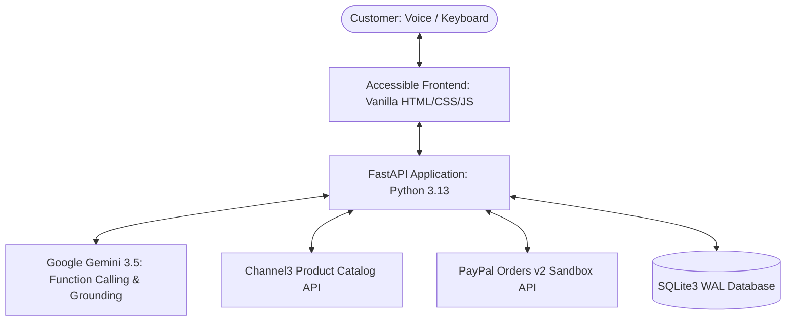

# PayPilot AI ACCESS

> Accessible, voice-first AI shopping agent with grounded product recommendations and buyer-approved PayPal Sandbox checkout.

[](https://github.com/princebuilds/paypilot-ai-access/actions/workflows/ci.yml)
[](LICENSE)

---

## Judge Quick-Start

Welcome, Hackathon Judges! PayPilot AI ACCESS is pre-configured and ready to evaluate.

- **Hosted URL:** `https://your-hosted-app.onrender.com` *(Placeholder: project owner will update with live Render URL)*
- **Dedicated Sandbox Buyer Login:**
  - **Email:** `sb-buyer-example@personal.example.com` *(Placeholder: project owner will update with active credentials)*
  - **Password:** `your_sandbox_password` *(Placeholder)*
- **Sample Queries to Test (Voice or Text):**
  1. `"sturdy wooden walking stick under $40"` &rarr; Recommends natural wood walking canes with rubber stability tips from Wayfair and Walmart.
  2. `"jar opener for weak hands under $25"` &rarr; Recommends assistive kitchen grip openers from Menards, Kohl's, and The Container Store.
  3. `"handheld magnifying glass with light under $25"` &rarr; Recommends LED-illuminated magnifiers from Newegg and Wayfair.
- **What to Look For Checklist:**
  - [x] **Voice-First Accessibility:** Click "Speak" or toggle Voice Mode. Real-time editable transcript, Web Speech API integration, and automatic screen-reader live regions.
  - [x] **Anti-Fabrication Grounding:** AI recommendations contain only verbatim evidence extracted directly from Channel3 catalog snapshots. No hallucinated features or prices.
  - [x] **Activity Audit Panel:** Expand *"What the assistant did"* on results and receipt views to view an unalterable server-side timeline of searches, grounding runs, price locks, and verified captures.
  - [x] **Retailer Transparency:** Every card displays `"Sold by <retailer>"` and clarifies that checkout links navigate to merchants through Channel3 affiliate tracking.
  - [x] **Customer Budget & Price Lock:** Strict Decimal arithmetic, 10-minute price freeze quotes, and explicit buyer total confirmation. The AI recommends but can never spend.
  - [x] **Verified PayPal Sandbox Capture:** Server-side verification matching 4 non-negotiable invariants (order status `COMPLETED`, capture status `COMPLETED`, exact quote amount match, and `custom_id` internal order match) before issuing a receipt.

---

## The Problem and Audience

Online shopping interfaces present significant cognitive, physical, and sensory hurdles for older adults, individuals with motor or visual impairments, and first-time digital shoppers. Navigating dense category hierarchies, ambiguous product specifications, volatile pricing, and complex multi-page checkout flows frequently leads to frustration, confusion, or cart abandonment.

PayPilot AI ACCESS solves this by providing an accessible, voice-guided assistant that:
1. Searches real multi-retailer inventory via **Channel3**.
2. Grounds every recommendation in verbatim product facts and attributes using **Google Gemini**.
3. Enforces strict customer budget limits with server-locked quotes.
4. Allows the customer to approve a simulated **PayPal Sandbox** payment without the AI ever possessing authority to spend money.

## Product Preview

_TODO: [Screenshot or short GIF of the running app in docs/img/]_

---

## Features

- **Voice-First Shopping:** Natural speech interaction with real-time editable transcripts and auditory speech synthesis feedback.
- **Real Inventory from Channel3:** Live product listings, prices, availability, and merchant domain attributions.
- **Strict Grounding Validator:** Anti-fabrication engine verifying that model claims and prices match upstream data snapshots verbatim.
- **Customer-Controlled Budget Guard:** Server-locked quotes, Decimal arithmetic, and explicit customer confirmation.
- **Verified PayPal Sandbox Checkout:** Server-side order creation, capture, and verification matching internal order IDs and amounts.
- **Server-Side Activity Audit Trail:** Expandable event timeline detailing query latency, products retrieved, grounding pass rates, price locks, and capture confirmation.
- **Accessible Design:** WCAG-aligned focus navigation, ARIA live announcements, 4.5:1 contrast, 44px tap targets, and full keyboard navigation.

---

## System Architecture



---

## Tech Stack

- **Backend:** Python 3.13, FastAPI, Uvicorn, HTTPX
- **AI & Grounding:** Google GenAI SDK (`google-genai`), custom `grounding.py` validator
- **Commerce & Data:** Channel3 Search & Product Detail API
- **Payments:** PayPal Orders v2 Standard Checkout (Sandbox)
- **Database:** SQLite3 with WAL mode (Standard Library)
- **Frontend:** Vanilla HTML5, CSS3, JavaScript (strict `textContent` DOM writes, zero third-party frameworks)
- **Testing & Gates:** Pytest, Respx (all network calls mocked in standard suite), Playwright, Axe-core

---

## Quick Start (Local Setup)

Setup in 8 simple steps:

1. **Clone the repository:**
   ```powershell
   git clone https://github.com/princebuilds/paypilot-ai-access.git
   cd paypilot-ai-access
   ```
2. **Create and activate a Python 3.13 virtual environment:**
   ```powershell
   py -3.13 -m venv .venv
   .\.venv\Scripts\Activate.ps1
   ```
3. **Install dependencies:**
   ```powershell
   pip install -r requirements.txt
   pip install -r requirements-dev.txt
   ```
4. **Configure environment credentials:**
   ```powershell
   Copy-Item .env.example .env
   # Edit .env and supply your API keys
   ```
5. **Run the static verification gate:**
   ```powershell
   python scripts/static_checks.py
   ```
6. **Run the automated test suite:**
   ```powershell
   pytest -q
   ```
7. **Start the application server:**
   ```powershell
   uvicorn app.main:app --host 127.0.0.1 --port 8000
   ```
8. **Open your browser:** Visit [`http://127.0.0.1:8000`](http://127.0.0.1:8000).

---

## Deploying to Render (Blueprint)

The repository includes a validated [`render.yaml`](render.yaml) blueprint for cloud hosting:

1. In your [Render Dashboard](https://dashboard.render.com), click **New +** &rarr; **Blueprint**.
2. Connect your repository: `princebuilds/paypilot-ai-access`.
3. Render automatically loads configuration from `render.yaml` and prompts for secret values:
   - `CHANNEL3_API_KEY`
   - `GEMINI_API_KEY`
   - `PAYPAL_CLIENT_ID`
   - `PAYPAL_CLIENT_SECRET`
4. Click **Apply**. Render installs requirements, launches `uvicorn`, and monitors health via `GET /api/health`.
5. Rate limits on Render are pre-configured to `120` requests/hour per IP so judges can freely evaluate the demo without experiencing throttling.

---

## Configuration

| Environment Variable | Description | Default |
|---|---|---|
| `CHANNEL3_API_KEY` | Channel3 API key | Required |
| `GEMINI_API_KEY` | Google Gemini API key | Required |
| `GEMINI_MODEL` | Pinned Gemini model identifier | `gemini-3.5-flash-lite` |
| `PAYPAL_CLIENT_ID` | PayPal Sandbox application client ID | Required |
| `PAYPAL_CLIENT_SECRET` | PayPal Sandbox application secret | Required |
| `PAYPAL_ENV` | Target PayPal environment | `sandbox` |
| `OFFLINE_TESTS` | 1 = synthetic fixtures, 0 = live external calls | `0` |
| `RATE_LIMIT_PER_HOUR` | Max /api/agent calls per IP per hour | `30` (local) / `120` (Render) |
| `DAILY_SEARCH_CAP` | Max global Channel3 searches per day | `1500` |

---

## Live vs Mock Test Results Table

All tests and gates are tracked against [docs/TRACEABILITY.md](docs/TRACEABILITY.md) and [docs/LIVE_TEST_REPORT.md](docs/LIVE_TEST_REPORT.md):

| Verification Area | MOCK Test Status | LIVE Test Status | Evidence Reference |
|---|---|---|---|
| Channel3 Search & Parser | **PASS** (10 mock tests) | **LIVE PASS** (Verified queries) | [docs/LIVE_TEST_REPORT.md](docs/LIVE_TEST_REPORT.md#channel3-live-integration-run) |
| Gemini Function Calling & Grounding | **PASS** (12 mock tests) | **LIVE PASS** (2.36s latency, zero hallucination) | [docs/LIVE_TEST_REPORT.md](docs/LIVE_TEST_REPORT.md#gemini-live-function-calling-run) |
| Quote & Budget Price Lock | **PASS** (8 mock tests) | **LIVE PASS** (Price freeze verified) | [docs/LIVE_TEST_REPORT.md](docs/LIVE_TEST_REPORT.md#phase-b4-quotes-and-orders-verification) |
| PayPal Sandbox Order & Capture | **PASS** (15 mock tests) | **LIVE PASS** (Order `3UW01444V17150529` captured) | [docs/LIVE_TEST_REPORT.md](docs/LIVE_TEST_REPORT.md#phase-b6-live-paypal-sandbox-checkout--capture) |
| Server-Side Activity Panel | **PASS** (4 mock tests) | **LIVE PASS** (DB rows matched, zero secrets) | [docs/evidence/phaseB6_activity_panel.txt](docs/evidence/) |
| Accessibility & Screen-Reader | **PASS** (0 axe violations) | **LIVE PASS** (Keyboard & voice verified) | [docs/ACCESSIBILITY_TEST.md](docs/ACCESSIBILITY_TEST.md) |

---

## API Reference

- `POST /api/agent`: Conversational intent extraction, clarifying questions, and grounded product search.
- `POST /api/quotes`: Product detail refresh and price-locked quote creation (10-minute expiry).
- `POST /api/quotes/{id}/confirm`: Explicit buyer confirmation of quote total.
- `POST /api/orders`: Order creation yielding PayPal order ID.
- `POST /api/orders/{id}/capture`: Server-side capture and 4-invariant verification.
- `POST /api/orders/{id}/cancel`: Buyer cancellation recording.
- `GET /api/orders/{id}`: Receipt retrieval.
- `GET /api/activity`: Server-side activity audit trail for session or order.
- `GET /api/health`: Operational health check (booleans only).

---

## Project Layout

```
app/
  __init__.py
  main.py          FastAPI factory, routes, static mount
  config.py        Typed settings and fail-fast validation
  database.py      SQLite3 with WAL mode and schema DDL
  schemas.py       Pydantic v2 data models
  errors.py        AppError definitions and exception handlers
  security.py      Session cookie management and rate limiters
  channel3.py      Channel3 HTTPX client and defensive offer parser
  agent.py         Gemini function-calling loop
  grounding.py     Product fact and evidence validator
  activity.py      Server-side activity event timeline generator
  quotes.py        Price locking, budget enforcement, and expiry
  paypal.py        PayPal OAuth, order creation, and capture verification
  routers/         activity.py, agent.py, quotes.py, orders.py, health.py
static/            Accessible UI (HTML, CSS, JS)
tests/             unit/, integration/, live/, fixtures/
scripts/           static_checks.py, live_smoke_test.py
docs/              PROGRESS.md, DECISIONS.md, TRACEABILITY.md, DEVPOST.md, DEMO_SCRIPT.md
```

---

## Sandbox Buyer Test Account

```text
Email:    sb-buyer-example@personal.example.com  (Placeholder: project owner will update with active credentials)
Password: your_sandbox_password                  (Placeholder)
```

---

## Limitations

- **Demo Merchant Gap:** Simulated Sandbox payments are captured into a developer demo merchant account. No physical retailer order is fulfilled or shipped.
- **Price Snapshots:** Product prices and stock availability reflect data captured at the recorded snapshot timestamp from Channel3.
- **Browser-Dependent Voice:** Speech recognition relies on browser support for the Web Speech API (best on Chrome and Edge). A full text fallback is always active and accessible.
- **Ephemeral Storage on Render:** On free-tier cloud deployments, local SQLite databases reset during container restarts or redeployments.
- **Free-Tier Wake Delay:** Free cloud hosting instances on Render may sleep after inactivity and take approximately 45–60 seconds to spin up on initial load.

---

## Security

Security is foundational to PayPilot AI ACCESS:
- **Zero Financial Agency:** The AI model is strictly restricted to recommending products. No tool or agent code can create, approve, or capture payments.
- **Customer Money Safety Invariants:** The browser never sends payment amounts. All purchases require an unexpired server quote and explicit customer total confirmation.
- **Capture Verification:** Capture requires order status `COMPLETED`, capture status `COMPLETED`, exact quote amount match, and internal order ID match.
- **Data Protection:** All third-party product text is treated as untrusted and rendered via `textContent` only (zero `innerHTML`).
- Refer to [SECURITY.md](SECURITY.md) for vulnerability disclosure procedures and secret management guidelines.

---

## Development Timeline

Built incrementally from scratch during the hackathon period, verified against real git history:

- **2026-11-09:** Project scaffolding, environment bootstrap, standard library SQLite WAL database, typed configuration, and static verification gate (`29e26a0`, `26c5785`).
- **2026-11-10:** Defensive Channel3 HTTPX client, nested offer parser, and live API smoke test verification (`ca54002`, `8ca889f`).
- **2026-11-10:** Gemini 3.5 function-calling integration, grounding validator, and conversational clarification router (`1c617e9`).
- **2026-11-10:** Price lock quotes service, budget enforcement, and PayPal Sandbox Orders v2 client (`5a9e9d4`).
- **2026-11-10:** Accessible voice-first frontend with Web Speech API, focus traps, ARIA live regions, and automated axe-core audits (`271fe2a`, `8d4fbe7`).
- **2026-11-11:** Live PayPal Sandbox capture verified with real buyer approval, recording all 4 invariants and debug IDs (`9c96357`). Release tagged `v0.5.0`.
- **2026-11-11:** Added retailer clarity ("Sold by <retailer>" + Channel3 affiliate disclosure) and server-side activity audit panel (`cbfcebc`, `3bb4547`).
- **2026-11-11:** Configured Render Blueprint deployment with judge-friendly rate limits (`926684d`).

---

## Future Work

1. **Agent Ready with a Real Merchant:** Upgrade from Sandbox checkout to live PayPal commerce with a direct merchant integration for physical fulfillment.
2. **Indian & Multi-Region Retailers:** Expand beyond US retail catalogs by integrating regional commerce APIs (e.g., ONDC, Blinkit, Amazon India) with multi-currency conversion.
3. **Multilingual Voice Support (Hindi `hi-IN`):** Add native multilingual voice recognition and speech synthesis to empower non-English speaking regional shoppers across India.

---

## Tools and AI Disclosure

- **AI Coding Assistant:** Google Antigravity IDE agent was used as an autonomous pair-programming assistant under explicit protocol-driven constraints.
- **Project Planning & Instruction Architecture:** Claude (Anthropic) was used by the owner for project planning, architecture review, and authoring `AGENTS.md`, `SPEC.md`, `PROTOCOL.md`, and `MASTER_BUILD_PROMPT.md`.
- **External AI Platform:** Google Gemini API (`google-genai`).
- **Data & Catalog Platform:** Channel3 API.
- **Payments:** PayPal Orders v2 Sandbox.

---

## License

This project is licensed under the MIT License - see the [LICENSE](LICENSE) file for details.
