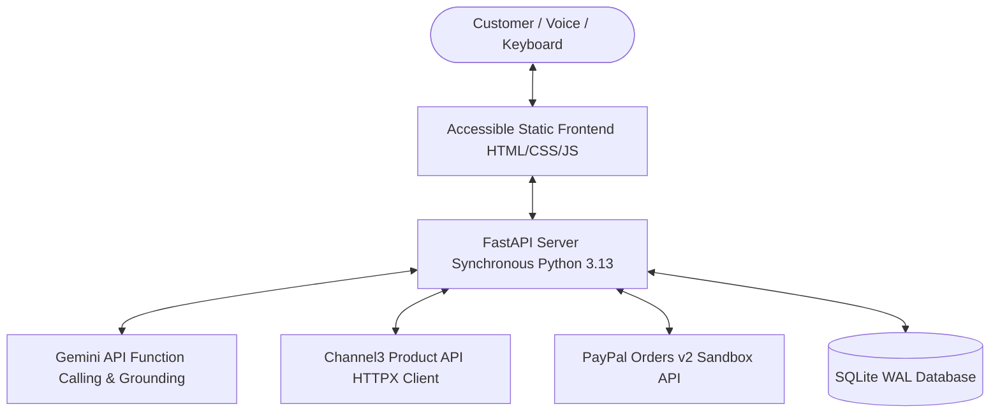

# PayPilot AI ACCESS

> Accessible, voice-first AI shopping agent with grounded product recommendations and buyer-approved PayPal Sandbox checkout.

[](https://github.com/princebuilds/paypilot-ai-access/actions/workflows/ci.yml)
[](LICENSE)

## The Problem and Audience
Online shopping interfaces present significant cognitive, physical, and sensory hurdles for older adults, individuals with visual impairments, and first-time digital shoppers. Navigating dense category hierarchies, ambiguous product specifications, volatile pricing, and complex multi-page checkout flows frequently leads to frustration or abandonment.

PayPilot AI ACCESS solves this by providing a voice-guided assistant that searches real inventory via Channel3, grounds every recommendation in verbatim product facts, enforces strict customer budget limits, and lets the customer approve simulated PayPal Sandbox checkout without the AI ever possessing authority to spend money.

## Product Preview
_TODO: [Screenshot or short GIF of the running app in docs/img/]_

## Features
- **Voice-First Shopping:** Natural speech interaction with real-time editable transcripts and auditory feedback.
- **Real Inventory from Channel3:** Live product listings, prices, availability, and merchant details.
- **Strict Grounding Validator:** Anti-fabrication engine verifying that model claims and prices match upstream data snapshots exactly.
- **Customer-Controlled Budget Guard:** Server-locked quotes, Decimal arithmetic, and explicit customer confirmation.
- **Verified PayPal Sandbox Checkout:** Server-side order creation, capture, and verification matching internal order IDs and amounts.
- **Accessible Design:** WCAG-aligned focus navigation, ARIA live announcements, 4.5:1 contrast, and keyboard support.

## System Architecture


## Tech Stack
- **Backend:** Python 3.13, FastAPI, Uvicorn, HTTPX
- **AI & Grounding:** Google GenAI SDK (`google-genai`), custom `grounding.py` validator
- **Commerce & Data:** Channel3 Search & Product Detail API
- **Payments:** PayPal Orders v2 Standard Checkout (Sandbox)
- **Database:** SQLite3 with WAL mode
- **Frontend:** Vanilla HTML5, CSS3, JavaScript (strict `textContent` DOM writes)
- **Testing:** Pytest, Respx (all network calls mocked in standard suite)

## Quick Start (Windows PowerShell)
1. Clone the repository:
   ```powershell
   git clone https://github.com/princebuilds/paypilot-ai-access.git
   cd paypilot-ai-access
   ```
2. Create and activate a Python 3.13 virtual environment:
   ```powershell
   py -3.13 -m venv .venv
   .\.venv\Scripts\Activate.ps1
   ```
3. Install dependencies:
   ```powershell
   pip install -r requirements.txt
   pip install -r requirements-dev.txt
   ```
4. Copy the environment template and configure keys:
   ```powershell
   Copy-Item .env.example .env
   # Edit .env with your credentials
   ```
5. Run the static verification gate:
   ```powershell
   python scripts/static_checks.py
   ```
6. Run the automated test suite:
   ```powershell
   pytest -q
   ```
7. Start the application server:
   ```powershell
   uvicorn app.main:app --host 127.0.0.1 --port 8000
   ```
8. Open your browser at `http://127.0.0.1:8000`.

### Deploying to Render (Blueprint)
The repository includes a validated [`render.yaml`](render.yaml) blueprint for one-click deployment:
1. In your [Render Dashboard](https://dashboard.render.com), click **New +** &rarr; **Blueprint**.
2. Select your repository: `princebuilds/paypilot-ai-access`.
3. Render automatically loads configuration from `render.yaml` and prompts for the required secret values:
   - `CHANNEL3_API_KEY`
   - `GEMINI_API_KEY`
   - `PAYPAL_CLIENT_ID`
   - `PAYPAL_CLIENT_SECRET`
4. Click **Apply**. Render installs requirements, launches `uvicorn`, and monitors health via `GET /api/health`.
5. Rate limits on Render are pre-configured to `120` requests/hour per IP so judges can freely evaluate the demo without experiencing rate-limit throttling.

## Configuration
| Environment Variable | Description | Default |
|---|---|---|
| `CHANNEL3_API_KEY` | Channel3 API key | Required |
| `GEMINI_API_KEY` | Google Gemini API key | Required |
| `GEMINI_MODEL` | Pinned Gemini model identifier | `gemini-3.5-flash-lite` |
| `PAYPAL_CLIENT_ID` | PayPal Sandbox application client ID | Required |
| `PAYPAL_CLIENT_SECRET` | PayPal Sandbox application secret | Required |
| `PAYPAL_ENV` | Target PayPal environment | `sandbox` |
| `OFFLINE_TESTS` | 1 = synthetic fixtures, 0 = live external calls | `0` |
| `RATE_LIMIT_PER_HOUR` | Max /api/agent calls per IP per hour | `30` |
| `DAILY_SEARCH_CAP` | Max global Channel3 searches per day | `1500` |

## How to Test: MOCK vs LIVE
- **MOCK Tests (`pytest -q`):** Executed by default in local testing and CI workflows. Network access is blocked via `respx` and injectable clients. Uses recorded sanitized fixtures.
- **LIVE Tests (`pytest -m live`):** Requires real API credentials in `.env`. Calls Channel3, Gemini, and PayPal Sandbox endpoints.

## Live vs Mock Test Results Table
| Verification Area | MOCK Test Status | LIVE Test Status | Evidence Reference |
|---|---|---|---|
| Channel3 Search & Parser | _TODO_ | _TODO_ | [docs/LIVE_TEST_REPORT.md](docs/LIVE_TEST_REPORT.md) |
| Gemini Function Calling & Grounding | _TODO_ | _TODO_ | [docs/LIVE_TEST_REPORT.md](docs/LIVE_TEST_REPORT.md) |
| Quote & Budget Price Lock | _TODO_ | _TODO_ | [docs/LIVE_TEST_REPORT.md](docs/LIVE_TEST_REPORT.md) |
| PayPal Sandbox Order & Capture | _TODO_ | _TODO_ | [docs/LIVE_TEST_REPORT.md](docs/LIVE_TEST_REPORT.md) |

## API Reference
- `POST /api/agent`: Conversational agent intent extraction and grounded product search.
- `POST /api/quotes`: Product detail refresh and price-locked quote creation.
- `POST /api/quotes/{id}/confirm`: Explicit confirmation of quote total.
- `POST /api/orders`: Order creation yielding PayPal order ID.
- `POST /api/orders/{id}/capture`: Server-side capture and verification.
- `POST /api/orders/{id}/cancel`: Buyer cancellation recording.
- `GET /api/orders/{id}`: Receipt retrieval.
- `GET /api/activity`: Server-side activity event timeline for session or order.
- `GET /api/health`: Operational health check (booleans only).

## Project Layout
```
app/
  __init__.py
  main.py          FastAPI factory, routes, static mount
  config.py        Typed settings and fail-fast validation
  database.py      SQLite3 with WAL mode and schema DDL
  schemas.py       Pydantic v2 data models
  errors.py        AppError definitions and exception handlers
  security.py      Session cookie management and rate limiters
  channel3.py      Channel3 HTTPX client and offer parser
  agent.py         Gemini function-calling loop
  grounding.py     Product fact and evidence validator
  activity.py      Server-side activity event timeline generator
  quotes.py        Price locking, budget enforcement, and expiry
  paypal.py        PayPal OAuth, order creation, and capture verification
  routers/         activity.py, agent.py, quotes.py, orders.py, health.py
static/            Accessible UI (HTML, CSS, JS)
tests/             unit/, integration/, live/, fixtures/
scripts/           static_checks.py, live_smoke_test.py
docs/              PROGRESS.md, DECISIONS.md, TRACEABILITY.md, etc.
```

## Sandbox Buyer Test Account
_TODO: Dedicated throwaway PayPal Sandbox buyer test account credentials will be published here upon Phase B8 completion._

## Limitations
- **Demo Merchant Gap:** Simulated Sandbox payments are credited to a demo merchant account and do not initiate real retail fulfillment.
- **Price Snapshots:** Product prices and stock availability reflect data captured at the recorded snapshot timestamp.
- **Browser-Dependent Voice:** Speech recognition relies on browser support for the Web Speech API (best on Chrome and Edge). Text fallback is always active.
- **Ephemeral Storage on Render:** On free-tier cloud deployments, local SQLite databases reset during container redeployments.
- **Free-Tier Wake Delay:** Free cloud hosting instances may require approximately one minute to spin up when idle.

## Security
Refer to [SECURITY.md](SECURITY.md) for vulnerability disclosure procedures and secret management guidelines.

## Development Timeline
_TODO: Development timeline will be generated from verified git commits across Phases B0-B8._

## Tools and AI Disclosure
- **AI Coding Assistant:** Google Antigravity IDE agent was used as an autonomous pair-programming assistant under explicit protocol-driven constraints. (Model version to be confirmed by project owner).
- **Project Planning & Instruction Architecture:** Claude (Anthropic) was used by the owner for project planning, architecture review and writing the AGENTS.md, SPEC.md, PROTOCOL.md and MASTER_BUILD_PROMPT.md instruction files.
- **External AI Platform:** Google Gemini API (`google-genai`).
- **Data & Catalog Platform:** Channel3 API.
- **Payments:** PayPal Orders v2 Sandbox.

## License
This project is licensed under the MIT License - see the [LICENSE](LICENSE) file for details.
